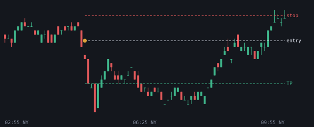
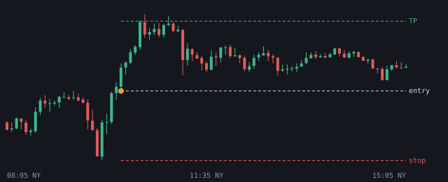
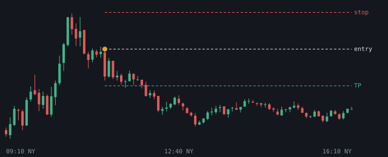
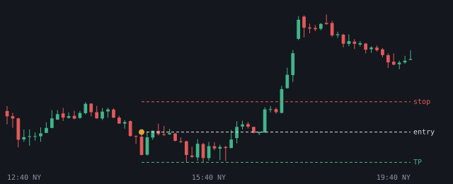

# 2026-10-20

Setups die de bot vandaag zag. Uitkomst volgens het logboek.

## EURUSD SHORT 04:55 (London, lage kans)

- Entry 1.123028 | stop 1.123802 | TP 1.121705 (1.71R)
- Sweep: Asia H | checks: Premium, SMT, IFVG
- Uitkomst: **entry niet op tijd geraakt** (+0.00R)

## NQ LONG 10:05 (NY AM, kans)

- Entry 29635.125 | stop 29390.75 | TP 29879.5 (1.0R)
- Sweep: PDL | checks: Discount, HTF FVG (POI), SMT, Silver Bullet, Sterke displacement, IFVG
- Uitkomst: **entry niet op tijd geraakt** (+0.00R)

## GOUD SHORT 11:10 (NY AM, kans)

- Entry 4162.650146 | stop 4175.299902 | TP 4150.000391 (1.0R)
- Sweep: London H | checks: 4h bias, 1h bias, Premium, HTF FVG (POI), Sterke displacement, IFVG, DOL >= 2.0R
- Uitkomst: **entry niet op tijd geraakt** (+0.00R)

## NQ SHORT 14:40 (NY PM, lage kans)

- Entry 29722.375 | stop 29788.25 | TP 29656.5 (1.0R)
- Sweep: Asia H | checks: 4h bias, Premium, Silver Bullet, Sterke displacement, IFVG, DOL >= 2.0R
- Uitkomst: **TP** (+1.00R)
