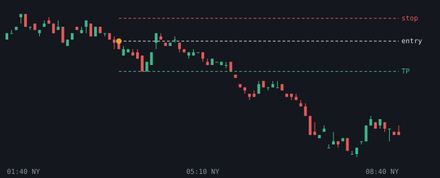
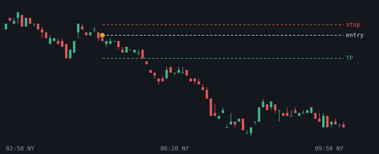
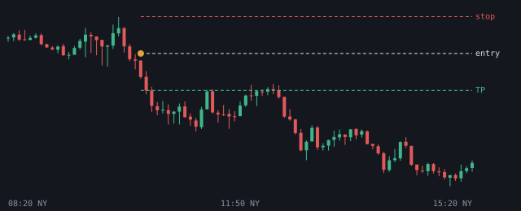
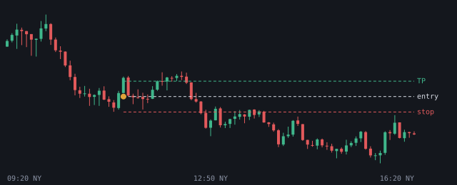

# 2026-10-22

Setups die de bot vandaag zag. Uitkomst volgens het logboek.

## EURUSD SHORT 03:40 (London, lage kans)

- Entry 1.12429 | stop 1.125193 | TP 1.123091 (1.33R)
- Sweep: PDH | checks: Silver Bullet, IFVG
- Uitkomst: **TP** (+1.33R)

## EURUSD SHORT 04:50 (London, lage kans)

- Entry 1.124101 | stop 1.12456 | TP 1.123091 (2.2R)
- Sweep: PDH | checks: DOL >= 2.0R
- Uitkomst: **entry niet op tijd geraakt** (+0.00R)

## NQ SHORT 10:20 (NY AM, kans)

- Entry 29477.625 | stop 29595.75 | TP 29359.5 (1.0R)
- Sweep: London H | checks: 4h bias, 1h bias, HTF FVG (POI), SMT, Silver Bullet, IFVG
- Uitkomst: **entry niet op tijd geraakt** (+0.00R)

## NQ LONG 11:20 (NY AM, kans)

- Entry 29285.0 | stop 29226.75 | TP 29343.25 (1.0R)
- Sweep: London L | checks: Discount, OTE 62-79%, SMT, IFVG, DOL >= 2.0R
- Uitkomst: **TP** (+1.00R)
