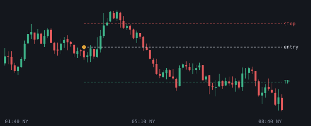
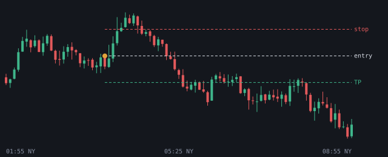
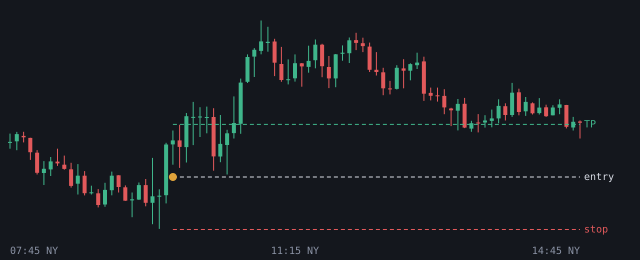
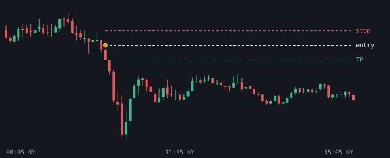

# 2026-10-23

Setups die de bot vandaag zag. Uitkomst volgens het logboek.

## NQ SHORT 03:40 (London, kans)

- Entry 29190.375 | stop 29244.5 | TP 29109.1875 (1.5R)
- Sweep: Asia H | checks: 4h bias, 1h bias, Premium, HTF FVG (POI), Silver Bullet, IFVG
- Uitkomst: **stop** (-1.00R)

## NQ SHORT 03:55 (London, lage kans)

- Entry 29190.375 | stop 29244.5 | TP 29136.25 (1.0R)
- Sweep: Asia H | checks: 4h bias, 1h bias, Premium, HTF FVG (POI), Silver Bullet, IFVG
- Uitkomst: **stop** (-1.00R)

## NQ LONG 09:45 (NY AM, kans)

- Entry 29071.5 | stop 28986.0 | TP 29157.0 (1.0R)
- Sweep: Asia L | checks: Discount, Sterke displacement, IFVG
- Uitkomst: **entry niet op tijd geraakt** (+0.00R)

## GOUD SHORT 10:05 (NY AM, kans)

- Entry 4034.400024 | stop 4041.4 | TP 4027.400049 (1.0R)
- Sweep: London H | checks: 4h bias, 1h bias, Premium, HTF FVG (POI), Silver Bullet
- Uitkomst: **entry niet op tijd geraakt** (+0.00R)
