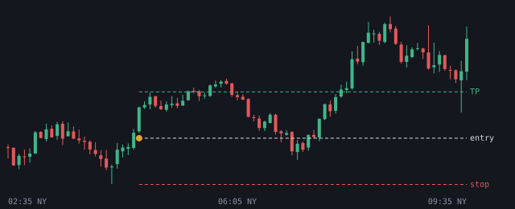
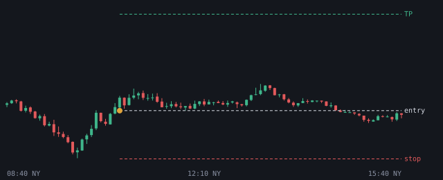

# 2026-10-26

Setups die de bot vandaag zag. Uitkomst volgens het logboek.

## NQ LONG 04:35 (London, lage kans)

- Entry 29114.375 | stop 29023.25 | TP 29205.5 (1.0R)
- Sweep: Asia L | checks: 1h bias, Discount, Sterke displacement
- Uitkomst: **entry niet op tijd geraakt** (+0.00R)

## GOUD LONG 10:40 (NY AM, kans)

- Entry 4029.0 | stop 4001.900049 | TP 4083.199902 (2.0R)
- Sweep: London L | checks: SMT, Silver Bullet, IFVG
- Uitkomst: **entry niet op tijd geraakt** (+0.00R)
