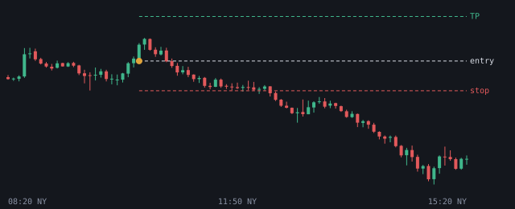
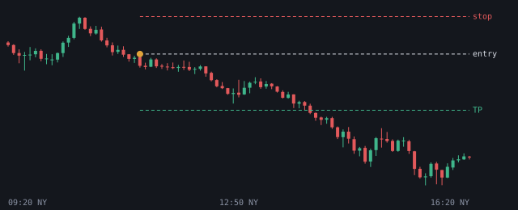

# 2026-11-02

Setups die de bot vandaag zag. Uitkomst volgens het logboek.

## NQ LONG 10:20 (NY AM, kans)

- Entry 28780.625 | stop 28638.0 | TP 28994.5625 (1.5R)
- Sweep: Asia L | checks: HTF FVG (POI), SMT, Silver Bullet, Sterke displacement, IFVG, DOL >= 2.0R
- Uitkomst: **stop** (-1.00R)

## NQ SHORT 11:20 (NY AM, kans)

- Entry 28716.75 | stop 28892.25 | TP 28453.5 (1.5R)
- Sweep: Asia H | checks: 4h bias, 1h bias, IFVG, DOL >= 2.0R
- Uitkomst: **entry niet op tijd geraakt** (+0.00R)
