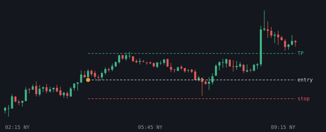
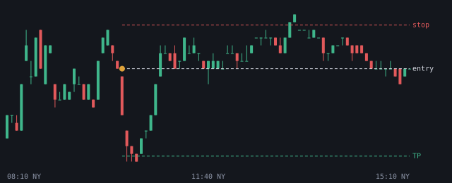

# 2026-11-03

Setups die de bot vandaag zag. Uitkomst volgens het logboek.

## NQ LONG 04:15 (London, kans)

- Entry 28172.25 | stop 28103.25 | TP 28269.0 (1.4R)
- Sweep: Asia L | checks: Discount
- Uitkomst: **TP** (+1.40R)

## EURUSD SHORT 10:10 (NY AM, kans)

- Entry 1.119445 | stop 1.120152 | TP 1.118031 (2.0R)
- Sweep: Asia H | checks: HTF FVG (POI), Silver Bullet, Sterke displacement, IFVG
- Uitkomst: **stop** (-1.00R)
