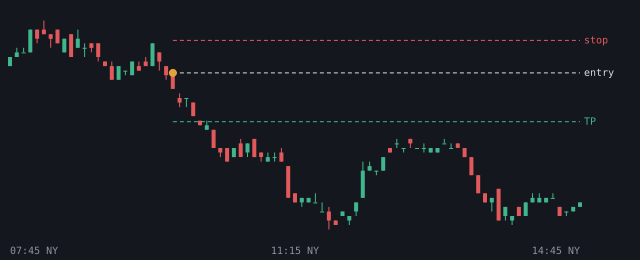

# 2026-11-04

Setups die de bot vandaag zag. Uitkomst volgens het logboek.

## EURUSD SHORT 09:45 (NY AM, kans)

- Entry 1.126063 | stop 1.126968 | TP 1.124706 (1.5R)
- Sweep: London H | checks: Premium, IFVG, DOL >= 2.0R
- Uitkomst: **entry niet op tijd geraakt** (+0.00R)
