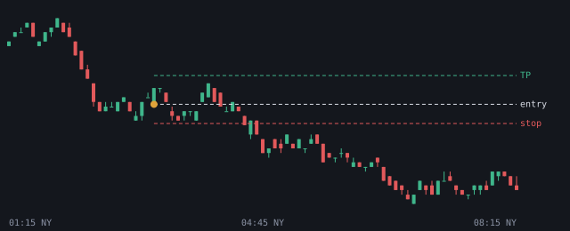
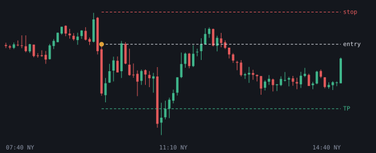
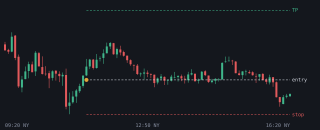

# 2026-11-05

Setups die de bot vandaag zag. Uitkomst volgens het logboek.

## EURUSD LONG 03:15 (London, kans)

- Entry 1.12467 | stop 1.124147 | TP 1.125454 (1.5R)
- Sweep: Asia L | checks: 4h bias, HTF FVG (POI), Silver Bullet, Sterke displacement, IFVG, DOL >= 2.0R
- Uitkomst: **stop** (-1.00R)

## GOUD SHORT 09:40 (NY AM, kans)

- Entry 4129.949951 | stop 4145.699805 | TP 4098.450244 (2.0R)
- Sweep: London H | checks: OTE 62-79%, Sterke displacement, IFVG, DOL >= 2.0R
- Uitkomst: **TP** (+2.00R)

## GOUD LONG 11:20 (NY AM, kans)

- Entry 4110.599854 | stop 4085.200098 | TP 4161.399365 (2.0R)
- Sweep: London L | checks: 4h bias, Discount, HTF FVG (POI), IFVG
- Uitkomst: **wacht op entry** (+0.00R)
