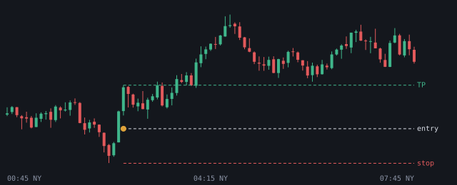

# 2026-11-06

Setups die de bot vandaag zag. Uitkomst volgens het logboek.

## NQ LONG 02:45 (London, kans)

- Entry 26908.125 | stop 26804.0 | TP 27039.0 (1.26R)
- Sweep: Asia L | checks: HTF FVG (POI), Sterke displacement, IFVG
- Uitkomst: **entry niet op tijd geraakt** (+0.00R)
