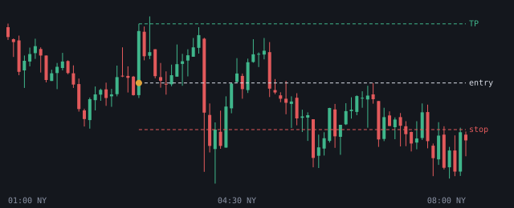

# 2026-11-10

Setups die de bot vandaag zag. Uitkomst volgens het logboek.

## NQ LONG 03:00 (London, kans)

- Entry 27974.875 | stop 27926.25 | TP 28036.5 (1.27R)
- Sweep: Asia L | checks: 4h bias, 1h bias, Discount, SMT, Silver Bullet, Sterke displacement, IFVG
- Uitkomst: **loopt nog** (+0.00R)
