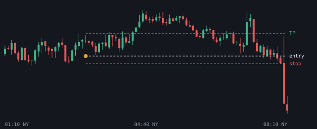

# 2026-11-12

Setups die de bot vandaag zag. Uitkomst volgens het logboek.

## NQ LONG 03:10 (London, kans)

- Entry 28187.875 | stop 28167.0 | TP 28249.75 (2.96R)
- Sweep: Asia L | checks: 4h bias, Discount, OTE 62-79%, Silver Bullet, IFVG, DOL >= 2.0R
- Uitkomst: **wacht op entry** (+0.00R)
