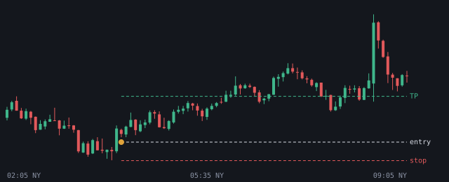
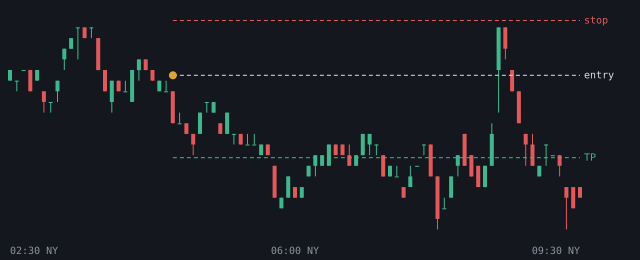

# 2026-11-13

Setups die de bot vandaag zag. Uitkomst volgens het logboek.

## NQ LONG 04:05 (London, kans)

- Entry 28285.625 | stop 28242.25 | TP 28392.5 (2.46R)
- Sweep: Asia L | checks: 4h bias, Discount, OTE 62-79%, SMT, Sterke displacement, IFVG, DOL >= 2.0R
- Uitkomst: **entry niet op tijd geraakt** (+0.00R)

## EURUSD SHORT 04:30 (London, kans)

- Entry 1.106501 | stop 1.107132 | TP 1.105554 (1.5R)
- Sweep: Asia H | checks: 4h bias, 1h bias, HTF FVG (POI), Sterke displacement, IFVG
- Uitkomst: **entry niet op tijd geraakt** (+0.00R)
