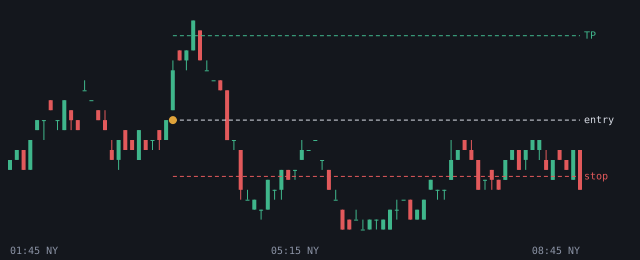
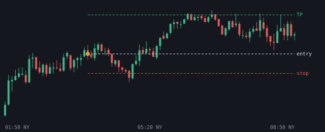
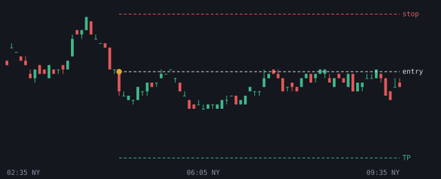
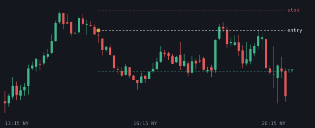
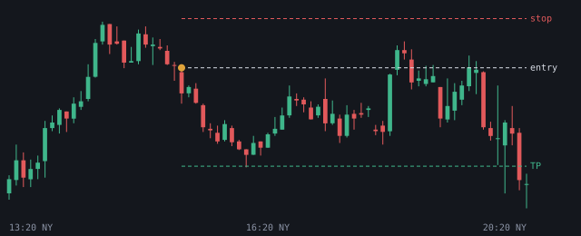

# 2026-11-16

Setups die de bot vandaag zag. Uitkomst volgens het logboek.

## EURUSD LONG 03:45 (London, kans)

- Entry 1.10205 | stop 1.101363 | TP 1.10308 (1.5R)
- Sweep: PDL | checks: Discount, Silver Bullet, Sterke displacement, IFVG
- Uitkomst: **stop** (-1.00R)

## GOUD LONG 03:50 (London, kans)

- Entry 3864.550049 | stop 3857.400049 | TP 3878.850049 (2.0R)
- Sweep: Asia L | checks: Discount, Silver Bullet, DOL >= 2.0R
- Uitkomst: **wacht op entry** (+0.00R)

## EURUSD SHORT 04:35 (London, kans)

- Entry 1.101746 | stop 1.103346 | TP 1.099347 (1.5R)
- Sweep: Asia H | checks: 4h bias, 1h bias, HTF FVG (POI), Sterke displacement, IFVG
- Uitkomst: **loopt nog** (+0.00R)

## GOUD SHORT 15:15 (NY PM, lage kans)

- Entry 3865.349976 | stop 3870.200049 | TP 3855.649829 (2.0R)
- Sweep: London H | checks: 4h bias, 1h bias, Premium, IFVG, DOL >= 2.0R
- Uitkomst: **wacht op entry** (+0.00R)

## GOUD SHORT 15:20 (NY PM, lage kans)

- Entry 3863.950073 | stop 3870.200049 | TP 3851.450122 (2.0R)
- Sweep: London H | checks: 4h bias, 1h bias, Premium, Sterke displacement, IFVG, DOL >= 2.0R
- Uitkomst: **wacht op entry** (+0.00R)
