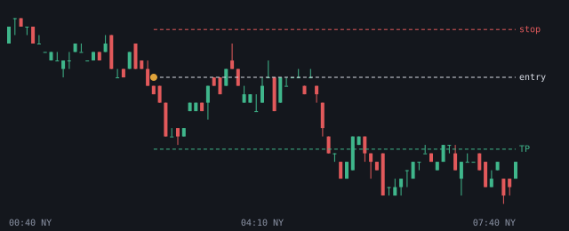
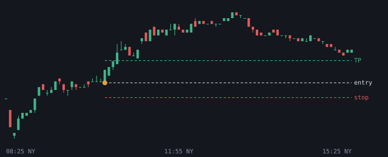
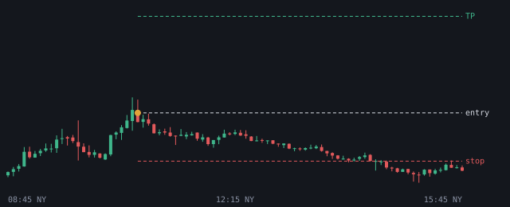

# 2026-11-17

Setups die de bot vandaag zag. Uitkomst volgens het logboek.

## EURUSD SHORT 02:40 (London, kans)

- Entry 1.100716 | stop 1.101402 | TP 1.099686 (1.5R)
- Sweep: Asia H | checks: 4h bias, 1h bias, Premium, IFVG
- Uitkomst: **TP** (+1.50R)

## EURUSD LONG 10:25 (NY AM, kans)

- Entry 1.099566 | stop 1.098942 | TP 1.100501 (1.5R)
- Sweep: PDL | checks: Discount, Silver Bullet, Sterke displacement, IFVG, DOL >= 2.0R
- Uitkomst: **entry niet op tijd geraakt** (+0.00R)

## GOUD LONG 10:45 (NY AM, kans)

- Entry 3884.900024 | stop 3856.499902 | TP 3941.700269 (2.0R)
- Sweep: London L | checks: Silver Bullet, IFVG
- Uitkomst: **wacht op entry** (+0.00R)
