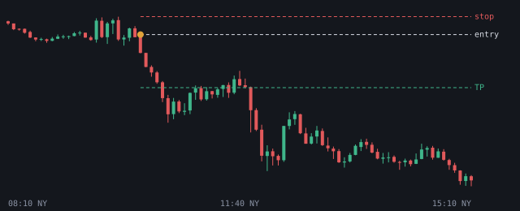
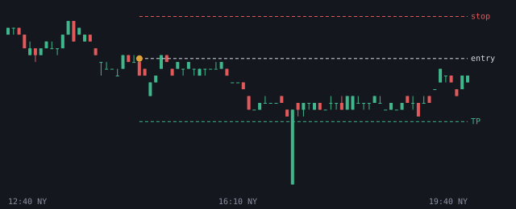

# 2026-11-19

Setups die de bot vandaag zag. Uitkomst volgens het logboek.

## NQ SHORT 10:10 (NY AM, kans)

- Entry 27703.5 | stop 27839.0 | TP 27303.0 (2.96R)
- Sweep: London H | checks: Premium, SMT, Silver Bullet, Sterke displacement, IFVG, DOL >= 2.0R
- Uitkomst: **entry niet op tijd geraakt** (+0.00R)

## EURUSD SHORT 14:40 (NY PM, lage kans)

- Entry 1.097996 | stop 1.09874 | TP 1.096881 (1.5R)
- Sweep: Asia H | checks: 4h bias, HTF FVG (POI), SMT, Silver Bullet, IFVG
- Uitkomst: **dicht 16:00** (+0.08R)
