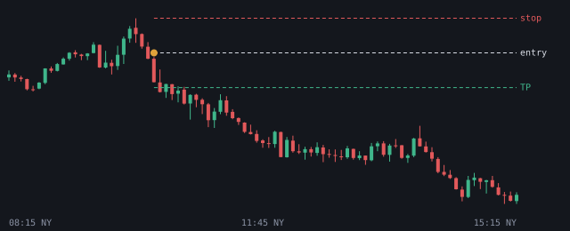
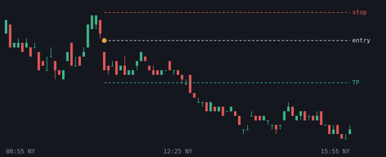

# 2026-11-20

Setups die de bot vandaag zag. Uitkomst volgens het logboek.

## NQ SHORT 10:15 (NY AM, kans)

- Entry 26265.875 | stop 26505.25 | TP 26026.5 (1.0R)
- Sweep: London H | checks: 4h bias, 1h bias, Silver Bullet, Sterke displacement, IFVG
- Uitkomst: **entry niet op tijd geraakt** (+0.00R)

## EURUSD SHORT 10:55 (NY AM, kans)

- Entry 1.099203 | stop 1.099948 | TP 1.098086 (1.5R)
- Sweep: London H | checks: 4h bias, Premium, SMT, Silver Bullet, IFVG, DOL >= 2.0R
- Uitkomst: **entry niet op tijd geraakt** (+0.00R)
