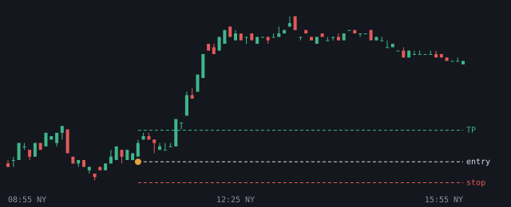
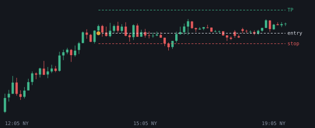

# 2026-11-25

Setups die de bot vandaag zag. Uitkomst volgens het logboek.

## EURUSD LONG 10:55 (NY AM, kans)

- Entry 1.094391 | stop 1.093653 | TP 1.095499 (1.5R)
- Sweep: Asia L | checks: 1h bias, SMT, Silver Bullet, IFVG, DOL >= 2.0R
- Uitkomst: **entry niet op tijd geraakt** (+0.00R)

## NQ LONG 14:05 (NY PM, lage kans)

- Entry 26048.25 | stop 25959.25 | TP 26246.0 (2.22R)
- Sweep: PDL | checks: Silver Bullet, DOL >= 2.0R
- Uitkomst: **stop** (-1.00R)
